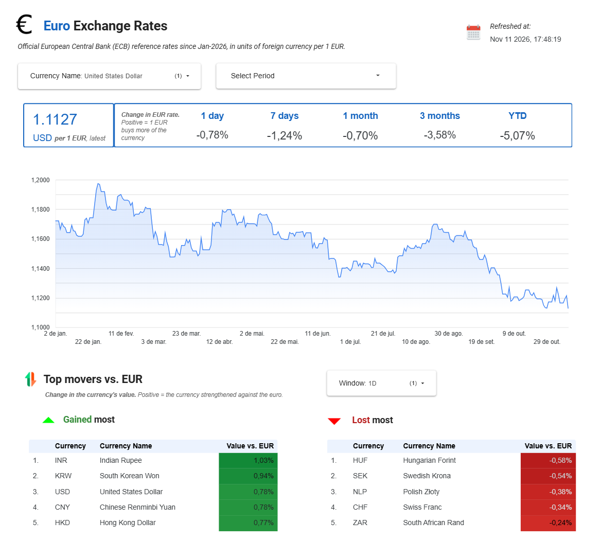
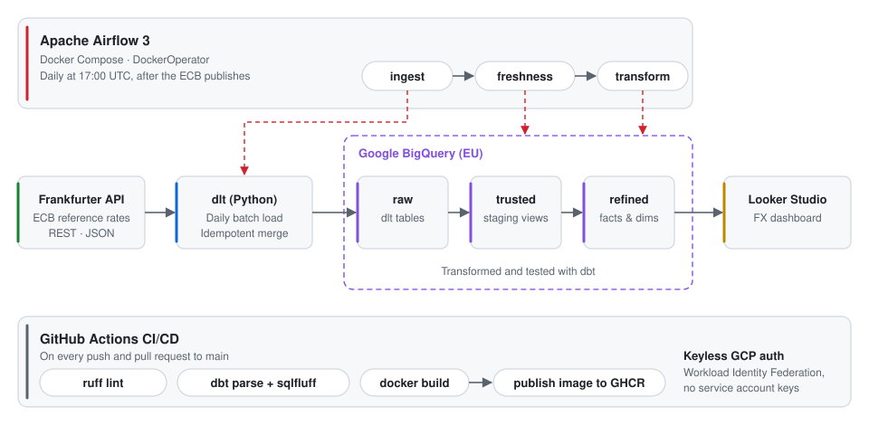

# EUR Exchange Rates

[](https://github.com/diegoscpereira/eur-exchange-rates/actions/workflows/ci.yml)


An end-to-end ELT pipeline that loads the European Central Bank's daily euro reference rates into BigQuery, models them with dbt and shows them in a Looker Studio dashboard. Airflow runs it every day.

## Dashboard

**[→ Open the live dashboard](https://datastudio.google.com/reporting/3ebc2510-abfd-4883-bcb6-62e1ebf5fb5f)**

[](https://datastudio.google.com/reporting/3ebc2510-abfd-4883-bcb6-62e1ebf5fb5f)

## Architecture

<p align="center">
  
</p>

1. **Extract & load:** [dlt](https://dlthub.com) pulls ECB rates and currency names from the [Frankfurter API](https://frankfurter.dev) into the BigQuery `raw` dataset.
2. **Transform:** [dbt](https://www.getdbt.com) builds staging views (`trusted`) and analytics tables (`refined`), with tests on every layer.
3. **Orchestrate:** Airflow runs `ingest → freshness → transform` every day at 17:00 UTC, after the ECB publishes. Each task runs in a Docker container built from the project image.
4. **Visualize:** Looker Studio reads the `refined` tables.

## Tech stack

| Layer | Tools |
|---|---|
| Ingestion | Python 3.12, dlt |
| Warehouse | Google BigQuery |
| Transformation | dbt Core, dbt_utils |
| Orchestration | Apache Airflow 3, Docker Compose |
| CI/CD | GitHub Actions, GHCR, Workload Identity Federation |
| Code quality | ruff, sqlfluff, dbt tests |
| Tooling | uv, Docker, Make |

## Data model

| Model | Layer | Description |
|---|---|---|
| `stg_frankfurter_api__ecb_rates` | trusted | Cleaned daily ECB rates |
| `stg_frankfurter_api__currencies` | trusted | ISO currency codes and names |
| `stg_frankfurter_api__dlt_loads` | trusted | dlt load metadata |
| `dim_calendar` | refined | One row per day, with ISO week, month, quarter and weekend flags |
| `fct_daily_exchange_rates` | refined | One rate per day and currency; weekends and holidays carry forward the last published rate |
| `fct_trailing_exchange_rate_changes` | refined | 1D, 7D, 1M, 3M and YTD % change for each currency |

## Design highlights

- **Medallion architecture:** `raw` → `trusted` → `refined` (bronze, silver, gold) separates landed data, cleaned data and analytics-ready tables.
- **Idempotent loads:** dlt merges on `(date, quote)`, so reruns never duplicate rows, and dbt uniqueness tests catch any duplicate that gets through.
- **Fail fast on stale data:** a source freshness check stops the run before transform if the data is outdated.
- **Least-privilege security:** one service account each for ingestion and dbt, used through impersonation. CI authenticates with Workload Identity Federation, so no keys are stored.
- **Safe development:** manual runs write to `dev_*` datasets, and only the scheduled run writes to the production datasets behind the dashboard.
- **Reproducible runs:** one Docker image, built by CI, runs dlt and dbt both locally and in Airflow.

## Project structure

```
├── ingestion/        # dlt pipeline (Frankfurter → BigQuery raw)
├── transformation/   # dbt project (trusted + refined models, tests)
├── orchestration/    # Airflow DAG and Docker Compose stack
├── infra/            # One-off GCP setup (Workload Identity Federation)
├── .github/workflows # CI: lint, dbt parse, Docker build, publish
├── Dockerfile        # Pipeline image shared by dlt and dbt
└── Makefile          # Shortcuts: make ingest, make dbt-build, make lint
```

## Running locally

### Prerequisites

- Docker, with Docker Compose
- The [`gcloud` CLI](https://cloud.google.com/sdk/docs/install)
- A GCP project with the BigQuery API enabled
- [uv](https://docs.astral.sh/uv/), only if you want to run the code outside Docker

### 1. Set up GCP access

The pipeline uses two service accounts:

| Service account | Used by | Roles |
|---|---|---|
| `dlt-loader` | ingestion | BigQuery Data Editor, BigQuery Job User |
| `dbt-transform` | dbt | BigQuery Data Editor, BigQuery Job User |

Grant your own Google account **Service Account Token Creator** on both. Then create the two sets of login credentials (Application Default Credentials, ADC):

```bash
# ADC for dbt: your user, dbt impersonates dbt-transform through profiles.yml
gcloud auth application-default login

# ADC for dlt: already impersonating dlt-loader, kept in a separate folder
CLOUDSDK_CONFIG=~/.config/gcloud-dlt gcloud auth application-default login \
  --impersonate-service-account=dlt-loader@<your-project>.iam.gserviceaccount.com
```

### 2. Configure

```bash
cp .env.example .env
```

Fill in `GCP_PROJECT_ID`, `DBT_SERVICE_ACCOUNT` and the **absolute** paths to both ADC files (`ADC_PATH`, `ADC_PATH_DLT`). Every variable is explained in `.env.example`.
### 3. Run the pipeline once

```bash
docker compose build

# First run: backfill from the start of the year (the models start at 2026-01-01)
docker compose run --rm ingest python ingestion/frankfurter.py --start 2026-01-01 --end 2026-11-10

# Build and test all dbt models (writes to the dev_trusted and dev_refined datasets)
docker compose run --rm transform
```

After the backfill, `docker compose run --rm ingest` with no arguments loads yesterday's rates.

### 4. (Optional) Schedule it with Airflow

```bash
cd orchestration
cp .env.example .env    # set AIRFLOW_UID (id -u) and DOCKER_GID (stat -c '%g' /var/run/docker.sock)
docker compose up -d
```

Open http://localhost:8081 (login `airflow` / `airflow`) and unpause the `eur_daily_rates` DAG. New DAGs start paused.

Airflow pulls the pipeline image before every task. `PIPELINE_IMAGE` in the root `.env` must therefore point to a registry image, for example `ghcr.io/diegoscpereira/eur-exchange-rates:latest`, not a local tag. Scheduled runs use the dbt `prod` target, which writes to the `trusted` and `refined` datasets.

### Developing without Docker

```bash
uv sync
set -a && source .env && set +a      # export the variables dbt needs

GOOGLE_APPLICATION_CREDENTIALS=$ADC_PATH_DLT GOOGLE_CLOUD_PROJECT=$GCP_PROJECT_ID \
  make ingest                        # load yesterday's rates as dlt-loader
make dbt-build                       # build and test; also make dbt-test, make lint
```

## Next steps

1. **Run in the cloud:** move scheduling to Cloud Run Jobs with Cloud Scheduler and add failure alerts. This removes the need for the 7-day reload window, which covers days when the local machine is off.
2. **Slim CI:** on pull requests, build and test only the changed dbt models (`state:modified+`) in an isolated dataset.
3. **Infrastructure as code:** manage datasets, service accounts and IAM with Terraform instead of setup scripts.
4. **Semantic layer:** define metrics once in dbt with MetricFlow, so every tool calculates them the same way.
